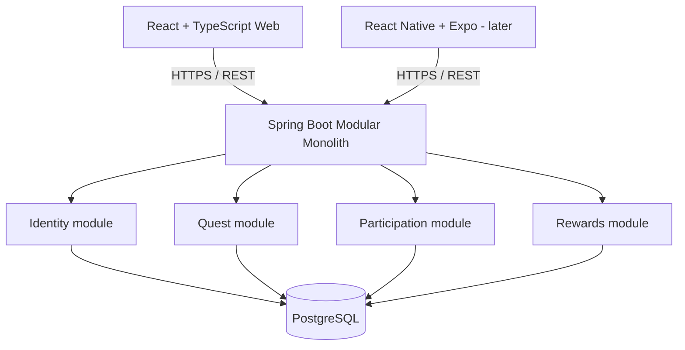

# SideQuest — Architecture v1

## Decisions
- **Web first.** Native mobile is a second client of the same versioned API.
- **One deployable backend.** Organize Spring Boot by domain: common, identity, quest, participation, reward.
- Controllers handle transport and validation; services handle business rules and transaction boundaries; repositories handle persistence.
- **PostgreSQL + Liquibase** for relational integrity and reproducible migrations.
- Target tables: users, quests, participations (unique user_id+quest_id), xp_ledger (unique participation_id).
- Start with synchronous HTTP; no cache, message broker or microservices without evidence.
- Local dev: Docker Compose for database. Later: GitHub Actions, Docker, AWS, logging, tracing, metrics.

## Initial endpoint contracts
`GET /api/v1/health` -> `{"status":"UP","service":"sidequest-api"}`
Later: `POST /api/v1/auth/register`, `POST /api/v1/auth/login`, `GET /api/v1/quests`, `GET /api/v1/quests/{id}`, `POST /api/v1/quests`, `PATCH /api/v1/quests/{id}`, publish, join, complete, and profile progress endpoints.

## Security
Sprint 1 health endpoint is public. Protected business endpoints are not released until identity/authorization are implemented. Authentication token/storage choice must be documented in an ADR.

## Quality attributes
Correctness first, tests for edge cases, measured performance, reliable deployments, least-privilege access, and clear failure handling.
